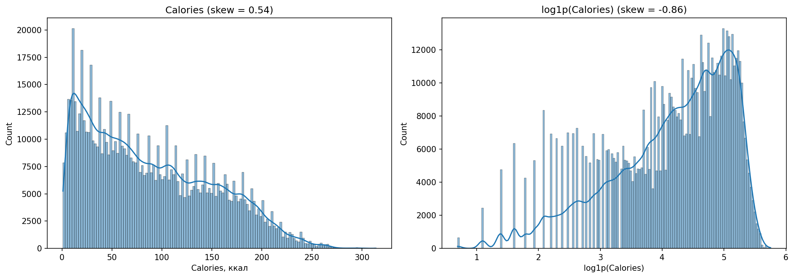
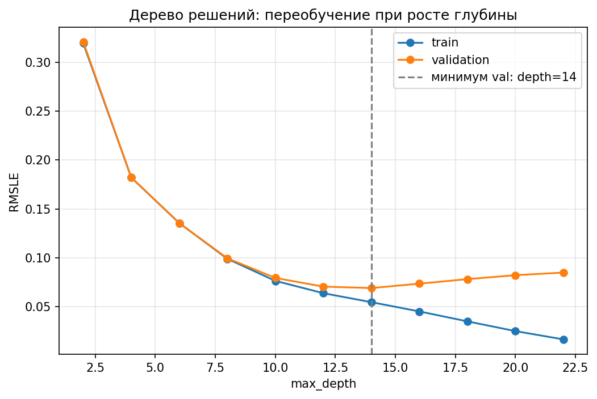
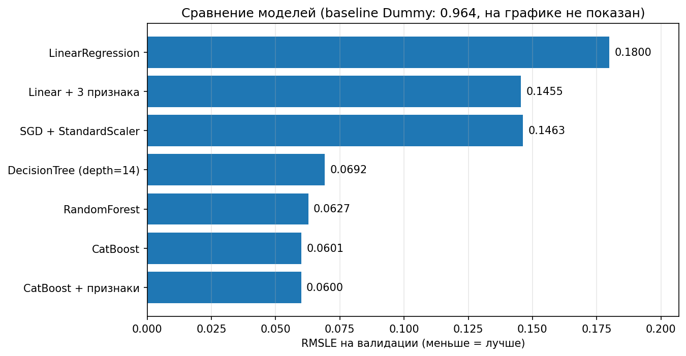
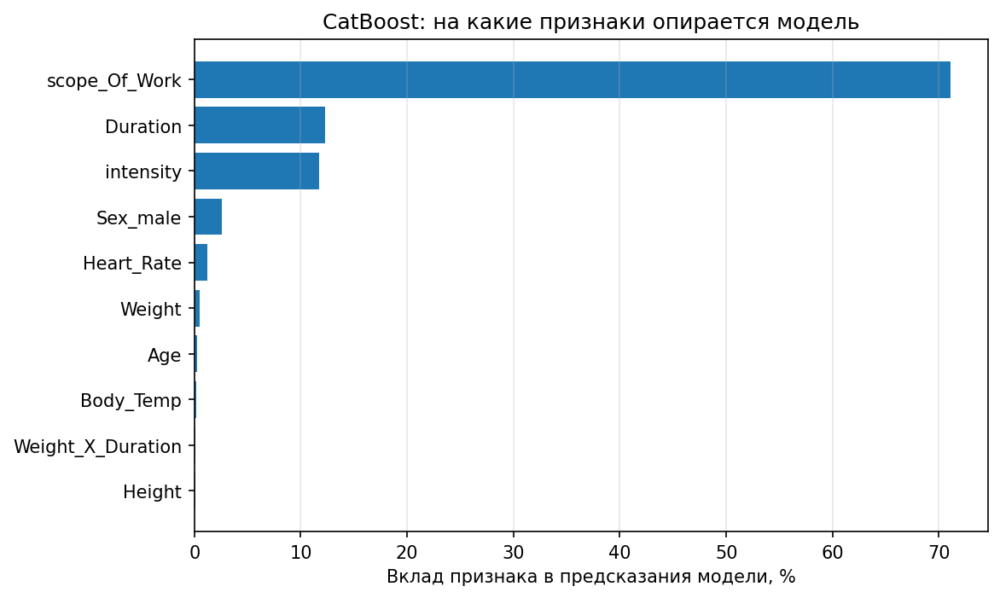

# Прогноз расхода калорий: Kaggle Playground S5E5

Регрессия на табличных данных: по параметрам человека и тренировки предсказываем, сколько калорий он сжёг. Прошёл путь от простейшего baseline до градиентного бустинга и сравнил модели на одной и той же метрике.

## Цель

Предсказать `Calories` по 7 признакам (пол, возраст, рост, вес, длительность тренировки, пульс, температура тела) в соревновании [Kaggle Playground Series S5E5](https://www.kaggle.com/competitions/playground-series-s5e5). Метрика: **RMSLE**. Решение отправлено как Late Submission.

Вторая цель: на реальной задаче последовательно пройти классический ML-пайплайн (baseline → линейные модели → деревья → ансамбли → бустинг) и понять, почему каждая следующая модель лучше или не лучше предыдущей.

## Данные

- train: 750 000 строк, 9 столбцов (`id`, `Sex`, `Age`, `Height`, `Weight`, `Duration`, `Heart_Rate`, `Body_Temp`, `Calories`), test: см. соревнование
- Таргет скошенный (skew 0.539); после `log1p` skew −0.857. Логарифм нужен не из-за формы распределения, а потому что метрика RMSLE равна RMSE на `log1p`.

## Что сделано

1. **Таргет:** обучение на `log1p(Calories)`, предсказания возвращаются через `np.expm1`. Так оптимизируется именно RMSLE.
2. **Кодирование:** `Sex` через one-hot с `drop_first=True` (защита от dummy variable trap).
3. **Признаки:** `intensity = Heart_Rate / (220 − Age)`, `scope_Of_Work = Duration · Heart_Rate`, `Weight_X_Duration = Weight · Duration`. Один и тот же `add_features` применяется к train и test.
4. **Валидация:** hold-out 10% (`random_state=42`) и 5-fold CV. Шум оценки CV около ±0.0007, поэтому разницу меньше этого значения не считаю улучшением.
5. **Лестница моделей:** Dummy → LinearRegression → Ridge → SGD (+StandardScaler в пайплайне) → DecisionTree → RandomForest → CatBoost.
6. **Бустинг:** CatBoost с `early_stopping_rounds`, финальное обучение на train+val с числом итераций по лучшей на валидации.
7. **Интерпретация:** `get_feature_importance`.

## Результаты (RMSLE, меньше = лучше)

| Модель | RMSLE (val) |
|---|---|
| Dummy (среднее) | 0.964 |
| LinearRegression | 0.180 |
| LinearRegression + 3 новых признака | 0.1455 |
| Ridge | 0.180 |
| SGD + StandardScaler | 0.1463 |
| DecisionTree (max_depth=14) | 0.0692 |
| RandomForest (30 деревьев, depth=14) | 0.0627 |
| CatBoost (lr=0.1) | 0.0601 |
| CatBoost + признаки (lr=0.1) | 0.0600 |

Результат на Kaggle (Late Submission, private / public):

| Модель | Private | Public |
|---|---|---|
| RandomForest | 0.0622 | 0.0605 |
| CatBoost | 0.0591 | 0.0574 |
| CatBoost + признаки | 0.0592 | 0.0573 |
| CatBoost + признаки, финал на train+val | 0.0592 | 0.0576 |

Для ориентира: скор 0.05916 на private соответствует примерно 1249-му месту в лидерборде соревнования (оценка по таблице, Late Submission в рейтинг не входит). Близость public (0.0576) и private (0.0592) говорит о том, что модель не подогнана под публичную часть теста.

**Ключевые факты:**

- Ошибка снижена с 0.964 (baseline) до 0.059: в ~16 раз; относительно линейной модели в ~3 раза.
- Переход от линейной модели к деревьям дал самый большой скачок (0.180 → 0.069): зависимость калорий от пульса и длительности нелинейная.
- Новые признаки улучшили линейную модель (0.180 → 0.1455), но не улучшили бустинг (0.0601 → 0.0600, в пределах шума): деревья сами строят такие взаимодействия.
- Ridge не изменил результат: при 675 тыс. строк и 7–10 признаках переобучения нет, регуляризация нечего исправлять.
- SGD без масштабирования расходится (RMSLE порядка 1e14), со `StandardScaler` в пайплайне сходится к результату линейной модели.
- Дообучение на всех данных (+10% строк с валидации) измеримого выигрыша не дало: private 0.05916 против 0.05922, разница в пределах шума.
- Снижение learning_rate с 0.1 до 0.05 не дало выигрыша (0.0600 на 2626 деревьях): плато.

## Технологии

Python, pandas, NumPy, scikit-learn, CatBoost, matplotlib, Kaggle Notebooks.

## Графики

**Распределение таргета до и после `log1p`**



**Переобучение дерева при росте глубины**



**Сравнение моделей**



**На что опирается CatBoost**



## Структура репозитория

```
├── calories.ipynb      # ноутбук с решением
├── images/             # графики для README
├── README.md
└── requirements.txt
```

## Как запустить

1. Скачать данные соревнования и положить `train.csv`, `test.csv` рядом с ноутбуком (или изменить путь в первой ячейке).
2. `pip install -r requirements.txt`
3. Запустить ноутбук сверху вниз.
